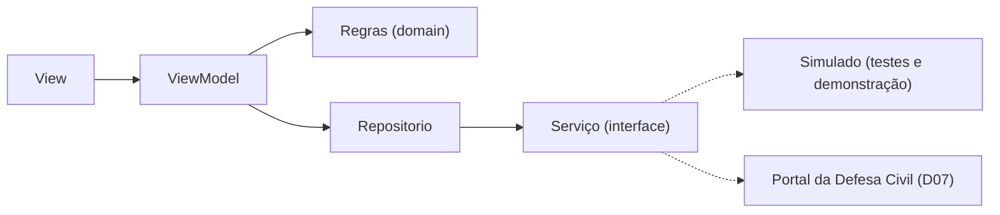

# Alerta Cheia Itajaí

[](https://github.com/C4v4lc4ntt/alerta-cheia-itajai/actions/workflows/ci.yml)


App mobile que reúne, num só lugar, o **estágio de alerta de cheia**, o **nível do rio Itajaí-Açu e da maré** e um **mapa colaborativo de ruas alagadas** em Itajaí (SC).

> ⚠️ **Complemento, não substituto.** Este app não emite alertas oficiais. Siga sempre a Defesa Civil de Itajaí. **Em emergência: 199 (Defesa Civil), 193 (Bombeiros), 192 (SAMU).**

## O problema

Em Itajaí a informação sobre cheias está espalhada: o SMS 40199 e o cell broadcast mandam só texto, o site da Defesa Civil precisa ser consultado manualmente e ninguém sabe em tempo real quais ruas estão alagadas. Há ainda a "enchente sem chuva": a água continua subindo depois que a chuva para, por causa da água que desce do Vale do Itajaí e da maré alta.

## Funcionalidades (MVP)

| # | Funcionalidade | Status |
|---|---|---|
| RF01 | Estágio de alerta, nível das 11 estações, boletim oficial e tábua de marés, com horário da medição | ✅ Concluído |
| RF02 | Escolha de bairros e notificação quando o estágio **muda** | 🚧 Em andamento |
| RF03 | Marcar ponto de alagamento (local e altura da água), sem identificação | 🔜 Sprint 3 |
| RF04 | Mapa dos pontos ativos (somem 6 h após a criação ou com 3 "já baixou") | 🔜 Sprint 3 |
| RF05 | Abrigos e contatos de emergência com ligação em um toque | 🔜 Sprint 4 |
| RF06 | Orientações antes/durante/depois e aviso de "enchente sem chuva" | 🔜 Sprint 4 |

Requisitos não funcionais: funciona sem internet com o último alerta salvo, não pede nome nem documento (LGPD), segue boas práticas de acessibilidade e mantém **≥ 80% de cobertura de testes na lógica**.

## Arquitetura

MVVM em camadas, como recomenda o guia oficial do Flutter. Detalhes e justificativa em [`docs/arquitetura.md`](docs/arquitetura.md). Decisões de projeto em [`docs/decisoes.md`](docs/decisoes.md) e telas de referência em [`docs/mockup/`](docs/mockup/).



## Desenvolvimento orientado a testes

Cada regra nasce em três commits, que ficam visíveis no histórico:

1. `test(rfXX): ...` — o teste é escrito e **falha** (vermelho)
2. `feat(rfXX): ...` — o código mínimo faz o teste **passar** (verde)
3. `refactor(rfXX): ...` — o código é melhorado com os testes ainda verdes

O CI (GitHub Actions) roda formatação, análise estática, todos os testes e a trava de 80% de cobertura na lógica a cada push, e compila para Android e iOS nos Pull Requests e no `main`.

## Stack

Flutter/Dart · flutter_test · integration_test · mocktail · http · Firebase Firestore (plano gratuito) · notificações locais · flutter_map + OpenStreetMap · GitHub Actions

## Como rodar

Pré-requisitos e instalação passo a passo no Windows: [`docs/guia-de-setup.md`](docs/guia-de-setup.md).

```bash
flutter pub get        # baixa as dependências
flutter test           # roda os testes
flutter test --coverage
flutter run            # abre no emulador ou celular conectado
```

> Os arquivos de configuração do Firebase (`google-services.json`, `GoogleService-Info.plist`, `firebase_options.dart`) **não** estão no repositório. Peça a um integrante do grupo ou gere os seus com `flutterfire configure`.

## Contexto acadêmico

Projeto de extensão do curso de Análise e Desenvolvimento de Sistemas da UNIVALI (Itajaí/SC), na disciplina "Planejamento e desenvolvimento de um projeto orientado a testes com programação mobile".

**Equipe:** Caleb Maurilio Natividade — Product Owner · Matheus Almeida Cavalcante da Silva — Scrum Master e desenvolvimento · Drenick Alves Feitosa — Time de desenvolvimento

Gestão do projeto: quadro Scrum no Trello, em sprints de 2 a 5.
