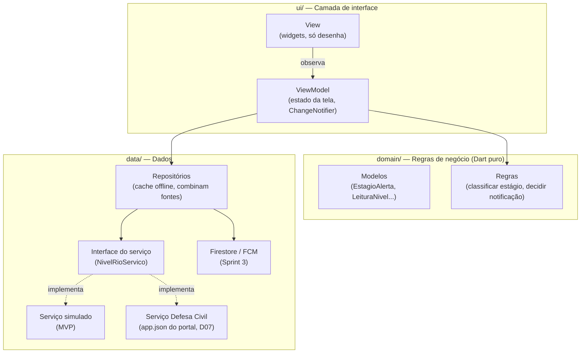

# Arquitetura — Alerta Cheia Itajaí

## Decisão: MVVM em camadas (padrão oficial do Flutter)

O app segue o **MVVM com camada de dados separada**, que é a arquitetura recomendada no guia oficial de arquitetura do Flutter (docs.flutter.dev/app-architecture). Três motivos para a escolha:

1. **Testabilidade (critério principal da disciplina).** A regra de negócio fica em classes Dart puras, sem nenhuma dependência de tela. Um teste unitário de "nível do rio → estágio" roda em milissegundos, sem emulador.
2. **Serviço simulado sem gambiarra.** A tela nunca sabe de onde vêm os dados. Ela conversa com uma *interface*; no MVP entregamos a implementação fake, e depois a da Defesa Civil, sem alterar uma linha da tela.
3. **Curva de aprendizado curta.** Usa só o que vem no Flutter (`ChangeNotifier` + `ListenableBuilder`) e injeção por construtor. Nada de BLoC ou Riverpod no MVP — são ótimos, mas acrescentam conceitos que não pagam o custo num app deste tamanho.

## As camadas



**Regra de dependência:** as setas só apontam para baixo. `domain/` não importa nada de `ui/` nem de `data/` (nem mesmo `package:flutter`).

## Equivalência com o mundo Java/Spring

| Flutter (este projeto) | Spring Boot |
|---|---|
| View (widget) | Template/página (Thymeleaf) ou o front |
| ViewModel | Controller + DTO de tela, só que com estado |
| `domain/regras` | Classes de regra/`@Service` sem dependências |
| Repositório | `@Repository` |
| Interface do serviço + fake | Interface + implementação `@Profile("test")` |
| Injeção por construtor em `main.dart` | Injeção por construtor do Spring |
| `mocktail` | Mockito |

## Estrutura de pastas

```
lib/
├── main.dart                 # ponto de entrada; monta as dependências
├── app.dart                  # MaterialApp + navegação inferior (4 abas)
├── core/tema/                # cores e tema (Archivo, paleta do mockup)
├── domain/
│   ├── models/               # entidades imutáveis
│   └── regras/               # lógica pura — alvo dos 80% de cobertura
├── data/
│   ├── catalogo/             # estações e cotas oficiais (reserva offline, D07)
│   ├── servicos/             # interfaces + implementações (fake, real)
│   └── repositorios/         # cache offline, combinação de fontes
└── ui/
    ├── comum/                # widgets reaproveitados
    ├── inicio/  mapa/  ajuda/  ajustes/   # uma pasta por tela (view + view_model)
test/                         # espelha lib/ (mesmo caminho, sufixo _test)
integration_test/             # fluxos completos (RF02 em diante)
```

## Onde cada requisito vai morar

| RF | domain/regras | data | ui |
|---|---|---|---|
| RF01 | classificador de estágio | serviço de nível (fake) + cache do último alerta | inicio |
| RF02 | "notificar na mudança" (modo "só a partir de Alerta", D04) | bairros escolhidos + FCM/notificação local | ajustes |
| RF03 | validação do registro | Firestore (pontos) | mapa/marcar |
| RF04 | expira 6 h após a última confirmação; some com 3 "já baixou" (D03) | Firestore | mapa |
| RF05 | — | lista de abrigos/contatos | ajuda |
| RF06 | "enchente sem chuva" | — | ajuda |

## Cobertura

A meta de 80% vale para `lib/domain` e `lib/data` (a lógica). Telas são cobertas por testes de widget, mas ficam fora do cálculo do mínimo no CI.
